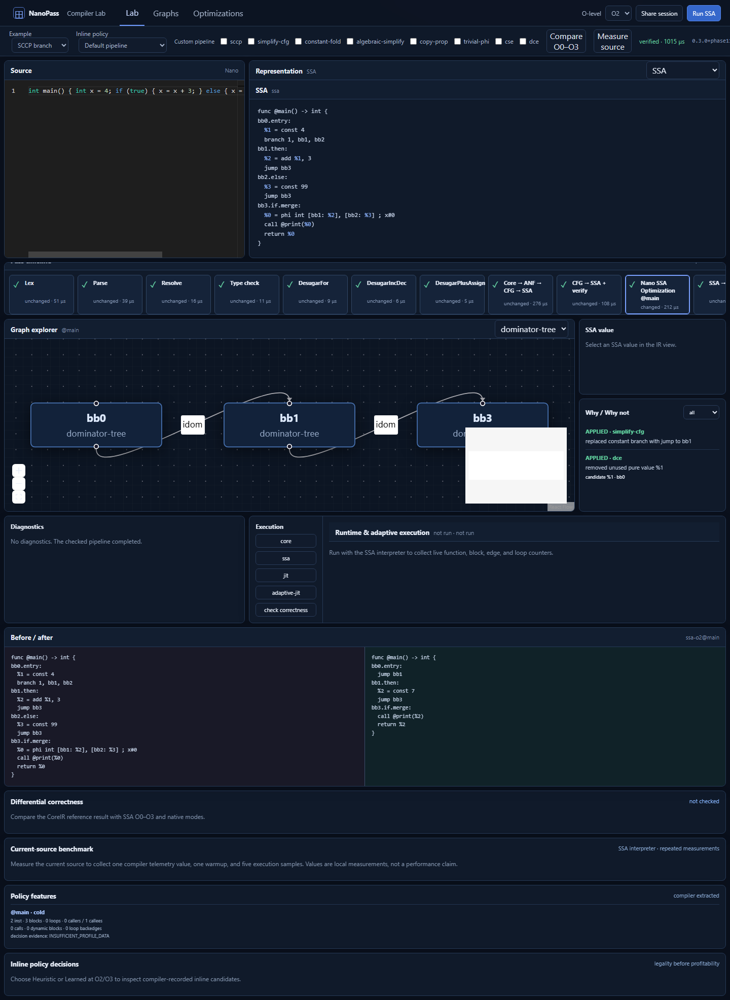
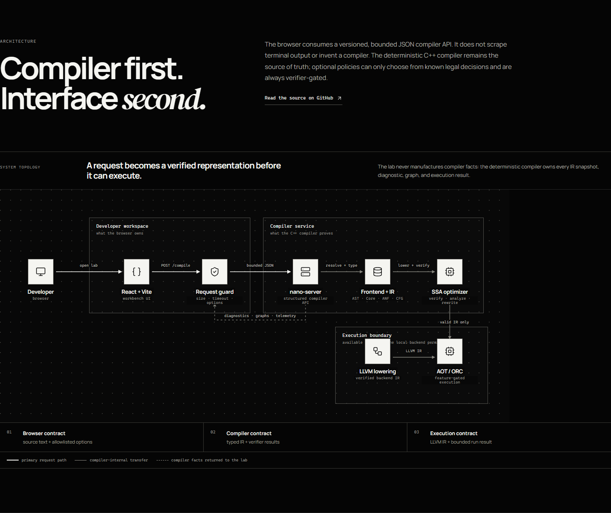
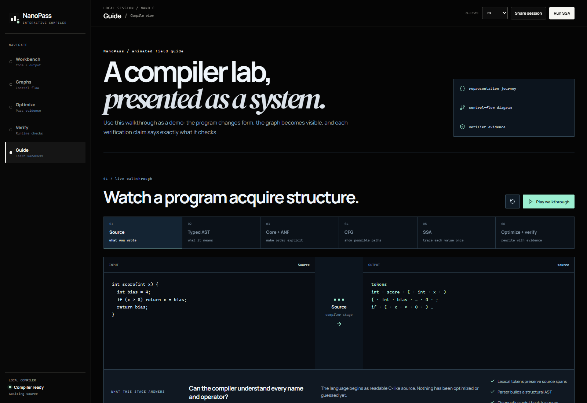

# NanoPass Compiler Lab

> A transparent C++20 and LLVM compiler laboratory where every important
> transformation is named, inspectable, measurable, and verifier-gated.



NanoPass is not an editor that prints a little LLVM at the end. It is a
compiler engineering platform for following a small C-like program from source
through typed intermediate representations, control-flow analysis, SSA,
optimization, verification, LLVM lowering, and bounded execution.

The deterministic compiler is the source of truth. The web lab displays
compiler-produced diagnostics, snapshots, graphs, pass telemetry, optimization
remarks, and verifier results; it does not fabricate explanations or execution
results.

## Why NanoPass?

Most compiler demos make the middle end disappear. NanoPass makes it the
product.

| Question | NanoPass answer |
| --- | --- |
| What happened to my source? | Inspect AST, CoreIR, ANF, CFG, SSA, optimized SSA, and LLVM snapshots. |
| Why did an optimization happen? | Read structured pass telemetry and compiler-recorded applied remarks. |
| Why did it not happen? | Inspect recorded missed-optimization reasons, not a generated guess. |
| How is correctness checked? | Run stage verifiers, LLVM verification, bounded differential testing, and fuzzing. |
| Can I see control flow? | Explore CFG, dominator, loop, and call graphs as deterministic text or DOT/JSON. |

## The pipeline

```mermaid
flowchart LR
  S[NanoPass C source] --> L[Lexer]
  L --> P[Parser]
  P --> A[Typed AST]
  A --> D[Desugaring passes]
  D --> C[CoreIR]
  C --> N[ANF]
  N --> G[CFG]
  G --> DA[Dominators · loops · call graph]
  DA --> SSA[SSA + verifier]
  SSA --> O[Nano SSA optimizer]
  O --> V[SSA verifier]
  V --> LL[LLVM IR]
  LL --> LV[LLVM verifier]
  LV --> X[Object / AOT / optional ORC JIT]
```



Each representation has a deterministic printer. CoreIR, ANF, CFG, and SSA
also have machine-checkable invariants; compiler bugs are surfaced as internal
errors instead of being mislabeled as user-source errors.



## What is implemented

- **Frontend** — recursive-descent parser, scope resolution, source-aware type
  checking, C-forward NanoPass syntax, and structured diagnostics.
- **Explicit middle end** — CoreIR, ANF, CFG, reachability, reverse postorder,
  dominators, dominance frontiers, natural loops, and an SSA builder with phi
  placement and renaming.
- **Verifier-backed optimization** — constant folding, algebraic simplification,
  SCCP, copy/trivial-phi propagation, DCE, CSE, CFG cleanup, LICM, strength
  reduction, and deterministic direct CFG-cloning inlining.
- **Interprocedural work** — scoped analysis caching, direct call graph and
  recursive-SCC detection, multi-block/multi-return/void inline continuations,
  and explicit cost, growth, and depth limits.
- **Execution and reliability** — CoreIR and SSA interpreters, differential
  comparison, grammar-aware generation, minimization support, runtime profiles,
  optional ORC JIT, and SSA-to-LLVM object/AOT lowering.
- **Observability** — `nano explain`, `nano verify`, IR snapshots, graphs,
  telemetry, optimization remarks, source/value provenance, and JSON API
  responses.
- **Compiler Lab** — Vite + React + TypeScript workbench with Monaco, live
  compiler snapshots, graph exploration, terminal-style commands, examples,
  and an animated interactive guide.

See [the precise project status](docs/STATUS.md) for stable, experimental, and
known-limitation boundaries.

## Quick start

NanoPass needs CMake 3.20+, a C++20 compiler, and a CMake-discoverable LLVM
development installation (LLVM 14+; LLVM 18 is the tested Linux target).

```sh
git clone https://github.com/TopoVista/nano-pass-compiler.git
cd nano-pass-compiler

cmake -S . -B build -G Ninja \
  -DLLVM_DIR=/usr/lib/llvm-18/lib/cmake/llvm \
  -DNANO_BUILD_WEB_SERVER=ON
cmake --build build --parallel

./build/compiler/nano explain examples/factorial.nano
```

On Windows, set `LLVM_DIR` to the directory containing `LLVMConfig.cmake`.
NanoPass fails clearly for an incomplete LLVM package rather than silently
working around it.

### Your first inspection

```sh
# Run front/middle-end invariant checks.
./build/compiler/nano verify examples/optimizer.nano

# Compare unoptimized and optimized SSA.
./build/compiler/nano emit examples/optimizer.nano --format=ssa -O0
./build/compiler/nano emit examples/optimizer.nano --format=optimized -O3

# Explain transformations, timing, and verifier gates.
./build/compiler/nano explain examples/loops.nano --verbose

# Produce a CFG source file for Graphviz.
./build/compiler/nano graph examples/loops.nano --cfg -o cfg.dot
dot -Tsvg cfg.dot -o cfg.svg
```

## NanoPass C in 30 seconds

NanoPass uses a familiar C-shaped surface syntax. Canonical type spellings are
`i32`, `truth`, and `unit`; `int`, `bool`, and `void` compatibility spellings
remain accepted.

```c
i32 score(i32 value) {
  i32 bias = 4;
  if (value > 0) {
    return value * bias;
  }
  return bias;
}

i32 main() {
  i32 result = score(7);
  print(result);
  return result;
}
```

```sh
./build/compiler/nano run examples/factorial.nano -O2
./build/compiler/nano emit examples/factorial.nano --format=anf
./build/compiler/nano emit examples/loops.nano --format=ssa
./build/compiler/nano optimize examples/optimizer.nano --passes=sccp,dce,cse
```

Read the actual language contract in [docs/language.md](docs/language.md).
The [examples](examples/) directory includes factorial, Fibonacci, fizzbuzz,
arrays, LICM, CSE, SCCP, PGO, and a bounded Dijkstra demonstration.

## CLI guide

```text
nano --help
nano --version

nano emit <file> --format=tokens|ast|desugar|core|anf|cfg|ssa|optimized|llvm
nano graph <file> --cfg|--dominator-tree -o output.dot
nano verify <file> [--format=json]
nano explain <file> [--verbose]
nano optimize <file> -O0|-O1|-O2|-O3 [--passes=sccp,dce]
nano run <file> -O2
nano profile <file> -o program.nprof
nano features <file>
nano jit <file>                         # requires NANO_BUILD_JIT=ON
```

Useful inspection switches include `--debug-pass-manager`, `--debug-analyses`,
`--print-pipeline`, `--remarks`, `--why-not-optimized`, and `--telemetry`.
The compiler only accepts its finite pass allowlist; custom pass text is never
executed as a shell command.

## Optimization, with evidence

NanoPass optimization levels are Nano pipelines, not aliases for LLVM’s
optimization level. The middle end keeps the optimizer understandable:

| Area | Implemented techniques |
| --- | --- |
| Scalar simplification | Folding, algebraic rules, copies, trivial phis, DCE |
| Sparse data flow | SCCP with executable-edge tracking |
| Value reuse | Dominance-aware CSE |
| Control flow | Branch folding, unreachable/trivial-block cleanup, phi repair |
| Loops | Natural-loop analysis, canonical preheaders, conservative LICM, selected strength reduction |
| Calls | Call graph/SCC recursion checks and verifier-gated direct CFG cloning |

Every optimizer pass records factual applied, missed, or analysis remarks.
Inlining is bounded by cost, code-growth, recursion, and inline-depth policies;
successful transformations are checked by the SSA verifier before the next
candidate is considered.

The optional learned policy is intentionally narrow: it chooses between known
legal inline decisions after deterministic legality and budget checks. It does
not produce IR, bypass verifiers, or make compiler correctness depend on an
LLM. See [the policy design](docs/optimization-policy.md).

## Verification and testing

NanoPass treats verification as a pipeline feature, not a release checklist.

```text
Parse → resolve → type check → desugar → CoreIR → ANF → CFG → SSA → optimize → LLVM
```

At the relevant stages, it checks structural IR contracts, CFG edge
consistency, dominance, phi coverage, def-use relationships, type
compatibility, and LLVM modules. The testing stack adds:

- CoreIR and SSA reference interpreters;
- differential O0–O3 execution checks;
- deterministic typed program generation and malformed-input fuzzing;
- failure reduction and stored reproducers;
- GitHub Actions for correctness, LLVM/JIT, sanitizers, browser, and container
  checks.

Run locally:

```sh
ctest --test-dir build --output-on-failure

# LLVM-independent differential and fuzz driver.
./build/compiler/nano_correctness differential examples/factorial.nano
./build/compiler/nano_correctness fuzz --seed=42 --cases=100

# Web checks.
cd web
npm ci
npm run typecheck
npm test -- --run
npm run build
```

Recorded validation evidence and the scope of each campaign live in
[docs/STATUS.md](docs/STATUS.md). Historical test counts are not claims about
your machine or configuration.

## Compiler Lab

The web app is an inspector over the versioned `nano-server` API, not a mock
dashboard.

```sh
# Terminal 1: start the compiler service.
cmake -S . -B build -G Ninja \
  -DLLVM_DIR=/usr/lib/llvm-18/lib/cmake/llvm \
  -DNANO_BUILD_WEB_SERVER=ON
cmake --build build --target nano-server --parallel
./build/compiler/nano-server --port=8080 --execution-policy=local-trusted

# Terminal 2: start the React app.
cd web
npm ci
npm run dev
```

Open `http://127.0.0.1:5173` for the public explanation, `/lab` for the
workbench, and `/guide` for the animated compiler presentation. The landing
page includes a codebase architecture brief; the guide expands it into an
interactive build tour that connects each compiler layer to concrete C++
modules, its input/output artifact, and its invariant. The lab lets you edit
source, format or generate a valid program, run safe compiler commands, inspect
representations and graphs, select SSA values, compare optimization levels, and
read verifier-backed explanations.



For a containerized local demonstration:

```sh
docker compose up --build
# Lab: http://127.0.0.1:3000
# API readiness: http://127.0.0.1:8080/api/v1/readiness
```

The container starts with `interpreter-only` execution. It is a restricted
public-demo setting, not a claim of multi-tenant sandboxing. Read
[docs/web-security.md](docs/web-security.md) before exposing it to others.

## Deploy the lab

The deployment split is intentional:

```text
Vercel static React application  ── HTTPS JSON ──>  Render nano-server API
```

The repository includes both deployment configurations:

- [`vercel.json`](vercel.json) — root-import Vercel build, static output, SPA
  rewrites, caching, and browser hardening headers;
- [`render.yaml`](render.yaml) — Dockerized LLVM 18 API, readiness probe,
  production origin allowlist, bounded source size, and interpreter-only
  execution.

Use the step-by-step [Render + Vercel deployment runbook](docs/deploy-render-vercel.md).
It covers environment variables, strict CORS, smoke tests, previews, rollback,
and the public-execution boundary. `VITE_*` values are browser-visible build
configuration, never a place for secrets.

## Repository map

```text
compiler/
  lexer/ parser/ ast/ sema/          Source language frontend
  ir/core/ ir/anf/ ir/cfg/ ir/ssa/   Explicit typed representations
  optimizer/                         Nano SSA optimization and policies
  backend/llvm/                      LLVM lowering, runtime, optional ORC JIT
  service/ server/                   Versioned JSON compiler service
  passes/                            Pass, analysis, telemetry infrastructure
tests/                               Unit, integration, service, and backend coverage
tools/                               Correctness, fuzzing, benchmark, and policy tools
examples/                            Readable NanoPass programs
docs/                                Architecture, language, IR, testing, deployment
web/                                 Vite + React Compiler Lab
```

## Build options

| CMake option | Default | Purpose |
| --- | --- | --- |
| `NANO_BUILD_TESTS` | `ON` | Build unit and integration tests |
| `NANO_BUILD_WEB_SERVER` | `OFF` | Build the `nano-server` JSON API |
| `NANO_BUILD_JIT` | `OFF` | Enable optional ORCv2 JIT support |
| `NANO_ENABLE_SANITIZERS` | `OFF` | Enable AddressSanitizer and UBSan where supported |
| `NANO_ENABLE_FUZZING` | `OFF` | Build fuzzing targets |
| `NANO_ENABLE_ALIVE2` | `OFF` | Enable optional Alive2 integration |

## Documentation

| Topic | Where to start |
| --- | --- |
| System design | [Architecture](docs/architecture.md) and [IR design](docs/ir-design.md) |
| Language | [NanoPass C language reference](docs/language.md) |
| SSA and analysis | [SSA design](docs/ssa-design.md), [loops](docs/loops.md), [analysis manager](docs/analysis-manager.md) |
| Optimizer | [Optimizer](docs/optimizer.md), [LICM](docs/licm.md), [inlining](docs/inlining.md) |
| Reliability | [Differential testing](docs/differential-testing.md) and [fuzzing](docs/fuzzing.md) |
| API and web | [Compiler API](docs/compiler-api.md), [Web Lab](docs/web-lab.md), [security](docs/web-security.md) |
| Deployment | [Render + Vercel runbook](docs/deploy-render-vercel.md) |
| Project state | [Status](docs/STATUS.md) and [roadmap](docs/ROADMAP.md) |

## Scope and safety

NanoPass is a compiler laboratory and educational/research platform. It is not
a general-purpose remote code-execution system. In particular:

- use `interpreter-only` for a public demonstration;
- do not expose local-trusted JIT execution to untrusted users;
- keep `NANOPASS_ALLOWED_ORIGINS` exact—never `*`;
- add authentication, rate limits, OS-enforced CPU/memory limits, and a
  dedicated worker boundary before any multi-user deployment.

## Contributing

Changes should preserve the central promise: transformations must be observable
and machine-checkable. Before opening a pull request, run the relevant C++ and
web suites, update docs for user-visible behavior, and avoid turning
experimental claims into stable ones.

See [docs/ROADMAP.md](docs/ROADMAP.md) for the active direction and
[docs/STATUS.md](docs/STATUS.md) for what is already complete.

---

**NanoPass Compiler Lab** — a compiler you can interrogate.
