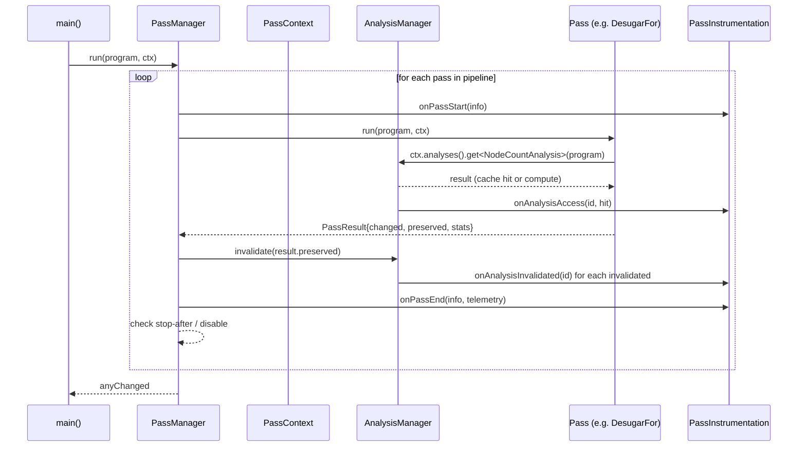

# NanoPass Compiler — Pass Manager Architecture

Phase 2 design document.  Written before implementation; updated as implementation
diverges from design.

---

## 1. Current Architecture (Phase 1 audit)

### Pipeline sequence (main.cpp)

```
Lex  →  Parse  →  ResolveScopesPass  →  TypeCheckPass
     →  runDesugarPipeline(program)
     →  LLVM codegen
```

### `runDesugarPipeline` — exact structure

```cpp
void runDesugarPipeline(vector<unique_ptr<Stmt>> &program, bool debug) {
  DesugarForPass      desugarFor;
  DesugarIncDecPass   desugarIncDec;
  DesugarPlusAssignPass desugarPlusAssign;

  for (auto &stmt : program) {          // ← iterates TOP-LEVEL statements
    stmt = desugarFor.transform(std::move(stmt));
    stmt = desugarIncDec.transformStmt(std::move(stmt));
    stmt = desugarPlusAssign.transformStmt(std::move(stmt));
  }
}
```

All three passes are applied to statement N before any pass touches statement
N+1.  Debug output (when `--debug-pass-manager` is used) therefore prints each
pass name once **per top-level statement**, not once per pass.

### Ownership model

| Layer | Type | Ownership |
|---|---|---|
| Program | `vector<unique_ptr<Stmt>>` | exclusive — passes move in / move out |
| Child statements | `unique_ptr<Stmt>` fields | exclusive within parent |
| Child expressions | `unique_ptr<Expr>` fields | exclusive within parent |
| Resolved symbols | `Symbol *` raw pointer in `VariableExpr`/`CallExpr` | non-owning; lifetime tied to `SymbolTable::ownedSymbols` |
| Type annotation | `LangType` value in `Expr::type` | value-owned in each node |

### Pass interface (Phase 1)

None.  Each pass is a plain `struct` with an ad-hoc method name:

| Pass | Entry method |
|---|---|
| `DesugarForPass` | `transform(unique_ptr<Stmt>)` |
| `DesugarIncDecPass` | `transformStmt(unique_ptr<Stmt>)` |
| `DesugarPlusAssignPass` | `transformStmt(unique_ptr<Stmt>)` |
| `ResolveScopesPass` | `resolve(const vector<unique_ptr<Stmt>> &)` |
| `TypeCheckPass` | `check(const vector<unique_ptr<Stmt>> &)` |

No base class.  No registry.  No timing.  No statistics.  No analysis
caching.  No invalidation.

---

## 2. Problems with the Current Architecture

### P1 — Passes run per-statement, not per-program

Debug output shows three pass names repeated four times for `loops.nano`
(which has four top-level `FunctionStmt` nodes):

```
[pass] DesugarFor
[pass] DesugarIncDec
[pass] DesugarPlusAssign
[pass] DesugarFor          ← repeated for second top-level stmt
...
```

Correct behaviour: each pass executes once, scanning the whole program.

### P2 — `FunctionStmt` bodies are never recursed into

All three desugaring passes lack a `FunctionStmt` case.  The passes only
reach inner nodes through `BlockStmt` at the top level.  A `for` loop inside
a function body is a `ForStmt` inside `FunctionStmt→body→stmts`.  Without a
`FunctionStmt` dispatch arm, `DesugarForPass` falls through to `return stmt`
and the body is never visited.  This is a correctness bug for programs that
are structured as functions (all real programs).

### P3 — No shared pass base class

Every pass caller must know the pass's private method name.  Cannot pipeline
passes uniformly.  Cannot add instrumentation without modifying the pipeline
manually.

### P4 — `changed` state is unknown

The pipeline cannot tell whether a pass modified the AST.  This blocks:
- fixpoint iteration
- analysis invalidation
- meaningful telemetry

### P5 — No analysis caching or invalidation

Symbol information and type annotations are computed once and embedded in
nodes (`Symbol *` raw pointers, `Expr::type`).  A post-transform pass that
needs to query symbol information must re-run the entire `ResolveScopesPass`
or operate blind.  There is no mechanism to invalidate stale cached results
after a transformation.

### P6 — Instrumentation is ad-hoc

`--debug-pass-manager` is a `bool` threaded through function parameters.
Each print site is an individual `if (debug) std::cerr << ...`.  No timing,
no structured output, no hooks for future telemetry.

### P7 — No pipeline registry

The set of passes is hardwired in `runDesugarPipeline`.  There is no way to
query available passes, customise the pipeline from the CLI, or validate a
user-supplied pass list.

---

## 3. Proposed Architecture

### 3.1 IR Unit

```cpp
enum class IRUnitKind { Program, Function, Statement, BasicBlock };
```

Current passes operate at `Program` granularity.  Future passes will operate
at `Function` (SSA, LICM, DCE) or `BasicBlock` (dataflow) granularity.  The
enum is the only thing added now — no `FunctionIR` or `BasicBlock` types yet.

### 3.2 Pass ID and metadata

Every pass has a stable string ID independent of its C++ type name:

```cpp
struct PassInfo {
    std::string_view id;          // "desugar-for"
    std::string_view name;        // "DesugarFor"
    std::string_view description; // "Lower for-loops to while-loops"
    std::string_view category;    // "desugaring"
    IRUnitKind       unit;        // IRUnitKind::Program
};
```

IDs are used in:
- `--debug-pass-manager` output
- `--stop-after=desugar-for`
- `--disable-pass=desugar-inc-dec`
- `nano passes` output
- JSON telemetry
- future AI advisor allowlist

### 3.3 Pass base class

```cpp
// compiler/passes/Pass.h
class Pass {
public:
    virtual ~Pass() = default;
    virtual PassInfo info() const noexcept = 0;
    virtual PassResult run(Program &program, PassContext &ctx) = 0;
};
```

`Program` is a thin named alias for `std::vector<std::unique_ptr<Stmt>>`.
It is not a new heap-allocated wrapper — just a type alias plus a small helper
that avoids exposing raw vector manipulation to pass internals.

### 3.4 PassResult

```cpp
struct PassResult {
    bool              changed   = false;
    PreservedAnalyses preserved = PreservedAnalyses::all();
    PassStatistics    stats;
};
```

`PassStatistics` is a flat map `string → variant<int64_t, double, string>`
so each pass can report its own named counters without a centralised enum.

### 3.5 PreservedAnalyses

```cpp
class PreservedAnalyses {
public:
    static PreservedAnalyses all();   // nothing invalidated
    static PreservedAnalyses none();  // everything invalidated

    template<typename AnalysisT> void preserve();
    template<typename AnalysisT> bool isPreserved() const;
private:
    bool allPreserved_ = false;
    std::unordered_set<std::type_index> preserved_;
};
```

Uses `std::type_index` internally — not exposed in pass-manager output.
Passes declare preservation with human-readable analysis IDs via a parallel
string registry.

### 3.6 PassContext

```cpp
class PassContext {
public:
    AnalysisManager  &analyses();
    bool              isDebugPassManager() const;
    bool              isDebugAnalyses() const;
    std::ostream     &debugStream();
    const CompilerOptions &options() const;

    // Stop-after and disable-pass support
    bool shouldStopAfter(std::string_view passId) const;
    bool isPassDisabled(std::string_view passId) const;
};
```

`PassContext` does not own the IR.  It is not a god object.  It holds
references/pointers to:
- `AnalysisManager` (owned by `PassManager`)
- compiler option flags
- debug output stream

### 3.7 PassManager

```cpp
class PassManager {
public:
    void addPass(std::unique_ptr<Pass> pass);

    // Run the full pipeline.  Returns true if any pass changed the program.
    bool run(Program &program, PassContext &ctx);

    // Debugging / introspection
    void printPipeline(std::ostream &out) const;
};
```

Internal run loop (conceptually):

```
for each pass in pipeline:
    if disabled → skip
    emit PassStarted event
    start = steady_clock::now()
    result = pass->run(program, ctx)
    duration = steady_clock::now() - start
    emit PassFinished(result, duration)
    invalidateAnalyses(result.preserved)
    if shouldStopAfter(pass->info().id) → break
```

Passes run **once per full program**, not once per top-level statement.
Individual pass implementations recurse into the full AST internally.

### 3.8 AnalysisManager

```cpp
class AnalysisManager {
public:
    template<typename AnalysisT>
    const typename AnalysisT::Result &
    get(const Program &program);

    template<typename AnalysisT>
    void invalidate();

    void invalidateAll();

    // Debug hook
    std::function<void(std::string_view, bool /*hit*/)> onAnalysisAccess;
};
```

Each `AnalysisT` exposes:
- `static std::string_view id()`  — stable string ID
- `static std::string_view name()` — display name
- `Result compute(const Program &)` — pure computation, no side effects

The manager stores results as `unordered_map<type_index, any>`.  The `any`
holds `AnalysisT::Result` which is always a plain value type (copyable).
No analysis result holds pointers into AST nodes — only counts and depths.
This makes invalidation safe: dropping a cached result never leaves dangling
pointers.

### 3.9 Instrumentation

```cpp
struct PassInstrumentation {
    std::function<void(const PassInfo &)>                    onPassStart;
    std::function<void(const PassInfo &, const PassTelemetry &)> onPassEnd;
    std::function<void(std::string_view id, bool hit)>       onAnalysisAccess;
    std::function<void(std::string_view id)>                 onAnalysisInvalidated;
};
```

`PassManager` holds a `PassInstrumentation` instance.  `PassContext` exposes
a reference to it so passes can fire events if needed.  The default
instrumentation does nothing.  The CLI debug mode installs a printing
instrumentation.

### 3.10 PassRegistry

A static registry of all known passes.  Accessed via `PassRegistry::get()`.
Populated at program start by static initializers (one per pass translation unit).
Used for:
- `nano passes` / `nano analyses` output
- `--stop-after` / `--disable-pass` validation
- custom pipeline construction from `--passes=`

---

## 4. Migration Strategy

### Step 1 — Infrastructure headers (no behaviour change)
Create `Pass.h`, `PassResult.h`, `PreservedAnalyses.h`, `PassContext.h`,
`PassManager.h`, `AnalysisManager.h`, `PassRegistry.h`.  Nothing in
`main.cpp` changes yet.  Build must still succeed.

### Step 2 — Implement analyses
`NodeCountAnalysis` and `ASTDepthAnalysis`.  Add unit tests.  No pass
migration yet.

### Step 3 — Migrate desugaring passes
Give each existing `DesugarXxxPass` a `PassInfo info()` method and a
`PassResult run(Program &, PassContext &)` entry point.
Fix the `FunctionStmt` recursion gap.
Add `rewrites` counter to each pass.
Keep the old `transform()`/`transformStmt()` methods as private implementation
helpers — they are tested indirectly, not removed.

### Step 4 — Wire `PassManager` into `main.cpp`
Replace `runDesugarPipeline` with:

```cpp
PassManager pm;
pm.addPass(std::make_unique<DesugarForPass>());
pm.addPass(std::make_unique<DesugarIncDecPass>());
pm.addPass(std::make_unique<DesugarPlusAssignPass>());
pm.run(program, ctx);
```

`PassContext` is constructed from `Options`.

### Step 5 — Hook instrumentation
`--debug-pass-manager` installs a `PassInstrumentation` that prints
structured output.  All existing `if (debug) std::cerr << "[pass] ..."` calls
are removed in favour of the instrumentation callbacks.

### Step 6 — Registry and CLI commands
Register passes in `PassRegistry`.  Implement `nano passes`, `nano analyses`,
`--print-pipeline`, `--stop-after`, `--disable-pass`.

### Step 7 — Tests
Pass-manager unit tests in `tests/pass_manager_tests.cpp`.

---

## 5. What Remains AST-Only

The following structures operate directly on the AST and will NOT be wrapped
in the PassManager in Phase 2:

- `Lexer` / `Parser` — not passes, produce the AST
- `ResolveScopesPass` — annotates AST in place (sets `Symbol *`); called once
  before the PassManager; its result is embedded in nodes and survives
- `TypeCheckPass` — annotates `Expr::type` in place; called before the
  PassManager; synthesised nodes produced by desugaring will have
  `LangType::Unknown()` for now
- LLVM codegen — consumes the desugared AST; not a `Pass` in Phase 2

These will be candidates for PassManager integration in Phase 3+ when CoreIR
is introduced.

---

## 6. Future Extension Points for CFG/SSA

### FunctionPass granularity

```cpp
// Future — not implemented in Phase 2
class FunctionPass {
public:
    virtual PassResult run(FunctionIR &fn, PassContext &ctx) = 0;
};
```

`PassManager` will iterate over functions and call `FunctionPass::run` for
each.  The `IRUnitKind::Function` enum value is reserved for this.

### Nested PassManagers

```cpp
// Future sketch
ProgramPassManager
  │
  ├── DesugarFor       (IRUnitKind::Program)
  ├── DesugarIncDec    (IRUnitKind::Program)
  └── FunctionPassManager
        ├── CFGBuilder   (IRUnitKind::Function)
        ├── SSABuilder   (IRUnitKind::Function)
        └── DCE          (IRUnitKind::Function)
```

`PassManager` is designed with no global singleton assumption.  Multiple
`PassManager` instances can coexist (one for desugaring, one for function-level
optimisation, one for experiments).

### Analysis invalidation with CFG

When a CFG-modifying pass runs:
```
CFG changed
→ invalidate DominatorTree
→ invalidate LoopInfo
→ preserve TypeInfo (types not affected by CFG changes)
```

This uses the same `PreservedAnalyses` mechanism.  Analysis types declare
their ID strings and use `std::type_index` internally.  CFG analyses will be
added as new `AnalysisT` types — no changes to `AnalysisManager` internals.

### Fixpoint iteration

```cpp
// Future
RepeatUntilStable<DCE, ConstantPropagation>
```

The `PassManager::run()` loop structure permits a wrapper pass that internally
runs a sub-pipeline in a loop until `changed == false`.  This is not
implemented in Phase 2 but is structurally possible.

---

## 7. Pass Lifecycle (Mermaid)



---

## 8. Source Location Policy

Synthesised nodes (created by desugaring) **must** receive a `SourceLocation`
copied from the node they replace.  Rationale: diagnostic messages during any
post-desugar pass or codegen step should point to the original source line,
not `-1:-1`.

Convention:
```cpp
// When replacing a ForStmt with {init; while(cond){body;inc}}:
auto whileNode = make_unique<WhileStmt>(...);
whileNode->loc = forStmt->loc;   // copy origin location
block->loc     = forStmt->loc;   // synthetic block also carries origin
```

---

## 9. Ownership Safety Invariants

1. `unique_ptr<Stmt>` / `unique_ptr<Expr>` — exclusive ownership throughout.
   No raw owning pointers.

2. `Symbol *` raw pointers in `VariableExpr` / `CallExpr` are invalidated if
   scope resolution re-runs.  The `AnalysisManager` must treat all `Symbol *`
   references as stale after any pass that synthesises new `VariableExpr`
   nodes without running scope resolution.

3. `AnalysisT::Result` types must be plain value types (structs of ints/strings).
   No pointers into AST nodes.  Invalidation = dropping the cached result.

4. `PassContext` holds references, not copies.  It must not outlive the
   `PassManager` that created it.

5. Passes must not retain references to program nodes across `run()` calls.
   A pass object may be re-used across runs (e.g., fixpoint iteration) only
   if it resets all mutable state at the start of `run()`.
